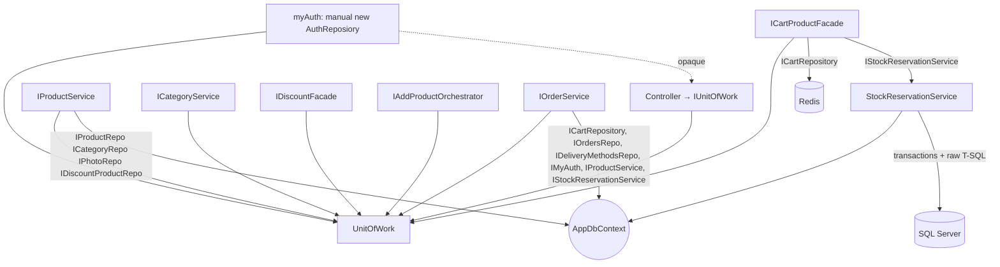
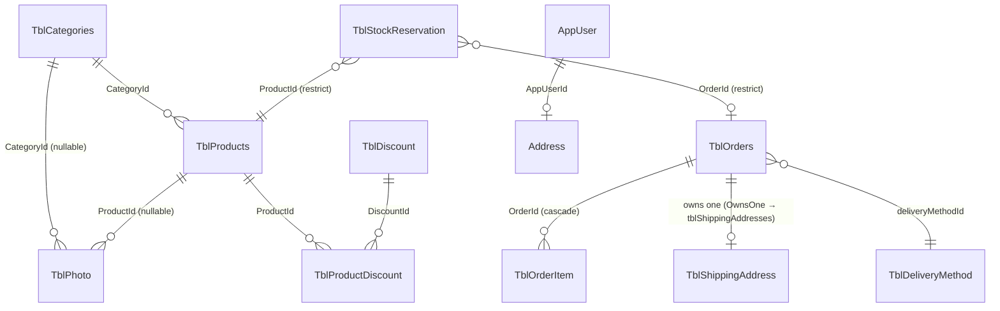
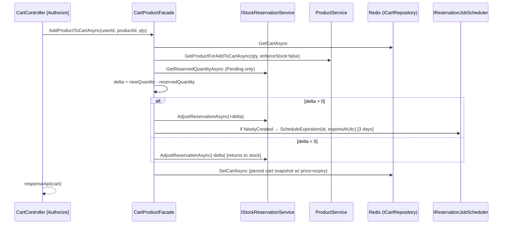
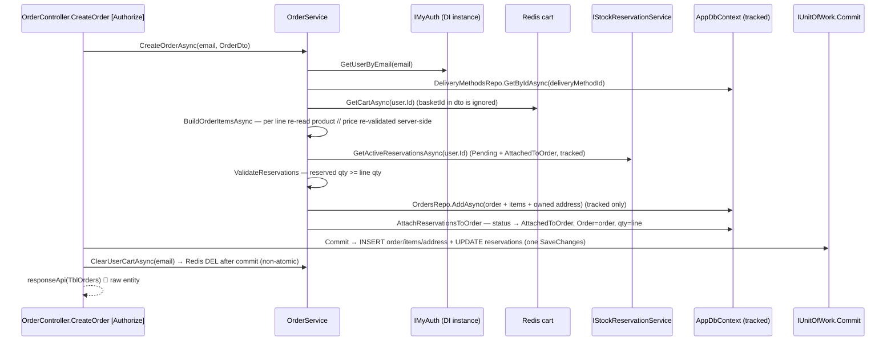
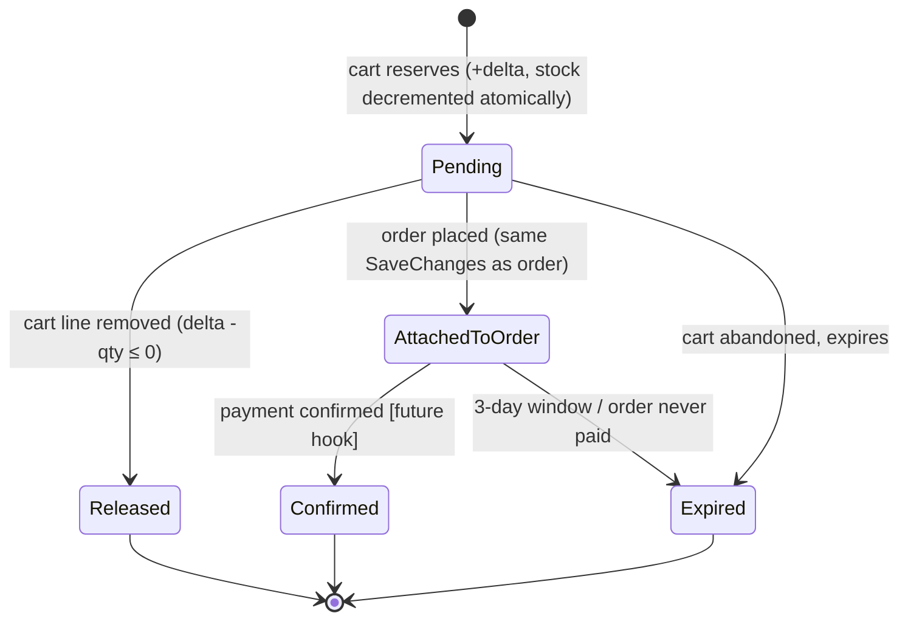

# ECom Backend — Architecture & Request Flows (Read-Only Audit)

- **Date:** 2026-10-13
- **Scope:** `Src\ECom.Api\ECom.Api.slnx` (.NET 10) — `Ecom.Core`, `ECom.Infrastructure`, `ECom.Api`, `ECom.Api.Tests`
- **Method:** every statement below was verified by reading the actual source (not comments or names) and following calls end-to-end. No application source file, migration, config, or DB object was created/edited/deleted during this audit.
- **Executed evidence:** `dotnet build` → 0 errors; `dotnet test` → **238 passed / 0 failed / 0 skipped** (SQL integration tests executed against a real SQL Server instance, not skipped).
- **Legend:** ✅ verified-by-reading · ⚠️ design concern · 🐞 confirmed defect · ❓ could not verify from the repo alone

---

## 1) Project structure


| Project | Layer | Project references | Notable packages |
|---|---|---|---|
| `Ecom.Core` | domain contracts, entities, DTOs, exceptions, pagination, AutoMapper profiles, cart models | — (none) | AutoMapper, MailKit/MimeKit, Identity.Stores, EF Design |
| `ECom.Infrastructure` | persistence (EF), repositories, Redis, application services, facades, orchestrators, calculators, Hangfire jobs, auth/token/email, DI registrations | → Core | EF Core/SqlServer, Identity, JwtBearer, Hangfire (+SqlServer), Redis, StackExchange |
| `ECom.Api` | controllers, validators (FluentValidation), exception handler, middleware, response wrapper, rate limiting, Program entry | → Infrastructure | Asp.Versioning.Mvc, FluentValidation, Hangfire.AspNetCore, OpenApi, Scalar, Redis, EF Design |
| `ECom.Api.Tests` | xUnit suites | → Api | xUnit, Moq, EF InMemory/Sqlite, Hangfire.MemoryStorage, Redis |

- All projects target `net10.0`; no circular references (verified from each `.csproj`). `Ecom.Core` has **no assembly reference** to Infrastructure; one cosmetic exception noted in §11 (dead `using`).

---

## 2) Request pipeline

```mermaid
flowchart LR
    R[HTTP request] --> E[UseExceptionHandler]
    E --> H[HSTS - production only]
    H --> S[UseSecurityHeaders nosniff/DENY/referrer]
    S --> HD[UseHangfireDashboard /hangfire]
    HD --> F[UseStaticFiles wwwroot]
    F --> CORS[UseCors AllowAngularApp]
    CORS --> OA[MapOpenApi + Scalar - dev only]
    OA --> HR[UseHttpsRedirection]
    HR --> RL[UseRateLimiter global + per-client]
    RL --> Z[UseAuthorization]
    Z --> M[MapControllers]
    M --> END(Response)
```



**Source:** `Program.cs:61-116`. Ordering facts that matter:

- `GlobalExceptionHandler` (outermost) converts everything to `application/problem+json`; internal details never leak (`GlobalExceptionHandler.cs:60-66`).
- Rate limiter sits **after** CORS (so 429 bodies still carry CORS headers) and **before** authorization/endpoints (every route is covered by the global window) — `Program.cs:112`.
- Recurring jobs are registered at startup: `purge-old-deleted-images` (`Program.cs:79-83`) and `expire-stock-reservations` (minutely safety-net sweep, `Program.cs:88-92`).
- OpenAPI + Scalar only in Development; Hangfire dashboard at `/hangfire` uses the default (local-requests-only) filter ❓ production exposure unproven.

---

## 3) Layer model and responsibilities

### 3.1 Web / API layer (`ECom.Api`)

| Type | Responsibility | Evidence |
|---|---|---|
| `Controllers\MyBaseController` | exposes `IUnitOfWork` to every controller; base route + `[ApiController]` | `MyBaseController.cs:6-17` |
| 5 controllers | endpoint surface, per-action validation, **Commit and compensation orchestration** | §6/§7 |
| `Validators\*` (7) | FluentValidation rules, registered via `AddValidatorsFromAssembly` | `Program.cs:55` |
| `ValidationHelper` | runs a validator, throws `BadRequestException` on failure | `ValidationHelper.cs:9-25` |
| `Exceptions\GlobalExceptionHandler` | single exception→HTTP mapping | `GlobalExceptionHandler.cs:34-66` |
| `Middleware\SecurityHeadersMiddleware` | nosniff / X-Frame-Options / Referrer-Policy | `SecurityHeadersMiddleware.cs:26-32` |
| `Registerations\RateLimitingRegisteration` | global sliding window + per-client token bucket | `RateLimitingRegisteration.cs:33-75` |
| `Helper\responseApi`, `FileParameterConverter` | success-wrapper; `IFormFile`→byte[] | — |

### 3.2 Application layer (`ECom.Infrastructure\Application\…`)

| Type | Responsibility | Evidence |
|---|---|---|
| `Services\ProductService` | catalog queries, price resolution (delegated), product CRUD, photo reconciliation, stock read for cart | `ProductService.cs` |
| `Services\CategoryService` | category CRUD + photo reconciliation | `CategoryService.cs` |
| `Facades\DiscountFacade` | discount create + product/category assignment (write side) | `DiscountFacade.cs` |
| `Facades\CartProductFacade` | cart read/modify **and** the reserve/release delta reconciliation | `CartProductFacade.cs` |
| `Orchestrators\AddProductOrchestrator` | product create + optional discount + compensation | `AddProductOrchestrator.cs` |
| `Services\OrderService` | order creation (Redis cart → order + reservation attach), order reads, cart clear | `OrderService.cs` |
| `Services\StockReservationService` | **single owner** of reservations; atomic T-SQL inside explicit transactions | `StockReservationService.cs` |
| `Services\HangfireReservationJobScheduler` | one-shot 3-day expiry job on reservation creation | `HangfireReservationJobScheduler.cs:15-26` |
| `Services\ReservationExpirationJobs` | Hangfire entry wrappers | `ReservationExpirationJobs.cs` |
| `Calculators\DiscountPriceCalculator` | **only** definition of "active discount" + price math | `DiscountPriceCalculator.cs:23-66` |

### 3.3 Persistence layer (`ECom.Infrastructure`)

| Type | Responsibility | Evidence |
|---|---|---|
| `Data\AppDbContext` | EF context; `ApplyConfigurationsFromAssembly` | `AppDbContext.cs:33-48` |
| `Repositories\GenericRepo<T,TKey>` | pure data access — add/track/read/soft-delete; **never calls `SaveChanges`** | `GenericRepo.cs` (grep: the only `SaveChangesAsync` is `UnitOfWork.cs:79`) |
| `Repositories\{Product,Category,Photo,Discount,DiscountProduct,Orders,OrderItems,ShippingAddresses,DeliveryMethods}Repo` | specialized queries (products/categories paging; orders includes; discount links) | — |
| `Repositories\UnitOfWork` | aggregates services + **single Commit**; also manually news `AuthReposiory` | `UnitOfWork.cs:46-83` |
| `Repositories\AuthReposiory` | Identity auth + email-token orchestration (lives in `Repositories` folder) | `AuthReposiory.cs` |
| `Redis\RedisCartRepository` | JSON cart in Redis, keyed by user id | `RedisCartRepository.cs` |
| `Data\Configurations\*` | EF mapping, seeds, filtered unique index, money precision | — |
| `Services\{ImageManagementService, EmailService, GenereateToken}` | file lifecycle + purge job; SMTP mail; JWT creation | — |

### 3.4 Domain layer (`Ecom.Core`)

Entities (`TblProducts`, `TblCategories`, `TblPhoto`, `TblDiscount`, `TblProductDiscount`, `AppUser`+`Address`, `TblOrders`, `TblOrderItem`, `TblShippingAddress`, `TblDeliveryMethod`, `TblStockReservation`), Cart models, DTOs, exceptions (`DomainException` hierarchy), service + repo interfaces, mappings, `Pagination<T>`.

---

## 4) Runtime dependency graph (DI)



Notes:

- `IUnitOfWork` is *the* controller-facing contract (intentional). It exposes **7 services + Commit**.
- `UnitOfWork` builds `myAuth` with `new AuthReposiory(...)` (`UnitOfWork.cs:69`) while `IMyAuth` also exists in DI (`infrastructureRegisteration.cs:58`) → **two instances per scope**. Same scoped `UserManager`/`SignInManager` are reused, `AuthReposiory` is stateless → **no state/lifetime bug**, but `AccountController` uses the manual instance while `OrderService` uses the DI instance. (A2)
- `StockReservationService` depends directly on `AppDbContext` and runs raw, parameterized T-SQL that uses EF's concurrency/RowVersion machinery — intentional and documented in its class comment.
- Generated JWT: claims `Name`, `Email`, `NameIdentifier` (`GenereateToken.cs:28-33`); cookie `token` set on login (`AccountController.cs:40-50`), read back by JwtBearer `OnMessageReceived` (`infrastructureRegisteration.cs:120-124`).

---

## 5) Data model & EF configuration



Configuration highlights:

- `TblStockReservation.Status` stored as string (`StockReservationConfig.cs:16-20`); `TblOrders.status` as string; `TblDiscount.Type` as int.
- **Filtered unique index** `IX_TblStockReservations_ActiveUserProduct` on `(UserId, ProductId)` where `Status IN ('Pending','AttachedToOrder')` (`StockReservationConfig.cs:36-39`) — one active reservation per user+product enforced by the DB.
- `RowVersion` (`[Timestamp]`) on every `BaseEntity<T>` gives optimistic concurrency; `DbUpdateConcurrencyException` → 409 (`GlobalExceptionHandler.cs:39`).
- Money everywhere is `decimal(18,2)`.
- **Migrations:** history was squashed into a single migration `20261012120040_WhooooleUpdateee` (creates everything + seeds delivery methods 1–3, category 1, product 1) + `20261012182814_AddStockReservation`. The 17 prior migrations are deleted in the working tree. ⚠️ Applying to an existing database (whose `__EFMigrationsHistory` still lists old migrations) will collide — **fresh-DB-only**.

---

## 6) Endpoint inventory

Versioning: default 1.0; readers = URL segment + `api-version` header (`Program.cs:34-43`). Route templates include `v{version:apiVersion}`, so unversioned URLs 404 (verified in prior audit).

| # | Method + route (base `api/v1`) | Auth | Rate-limit | Action → service path | Commit? |
|---|---|---|---|---|---|
| 1 | `GET /product/GetAll?page…` | anon | per-client | `ProductService.GetPageAsync` | — |
| 2 | `GET /product/GetById/{id}` | anon | per-client | `ProductService.GetByIdAsync` | — |
| 3 | `POST /product/Add` (multipart) | ✅ `[Authorize]` | per-client | `AddProductOrchestrator.ExecuteAsync` → `ProductService.AddAsync` (+optional discount) | ✅ + compensate on failure |
| 4 | `PUT /product/Update` (multipart) | ✅ `[Authorize]` | per-client | `ProductService.UpdateAsync` | ✅ |
| 5 | `DELETE /product/Delete/{id}` | ✅ `[Authorize]` | per-client | `ProductService.DeleteAsync` | ✅ |
| 6 | `POST /product/ApplyDiscount` | ✅ `[Authorize]` | per-client | `DiscountFacade.ApplyDiscountAsync` | ✅ |
| 7 | `POST /product/ApplyCategoryDiscount` | ✅ `[Authorize]` | per-client | `DiscountFacade.ApplyCategoryDiscountAsync` | ✅ |
| 8 | `GET /Category/GetAll?page…` | anon | per-client | `CategoryService.GetPageAsync` | — |
| 9 | `GET /Category/GetById/{id}` | anon | per-client | `CategoryService.GetByIdAsync` | — |
| 10 | `POST /Category/AddCategory` (multipart) | ✅ `[Authorize]` | per-client | `CategoryService.AddAsync` | ✅ + compensate |
| 11 | `PUT /Category/UpdateCategory` (multipart) | ✅ `[Authorize]` | per-client | `CategoryService.UpdateAsync` | ✅ |
| 12 | `DELETE /Category/DeleteCategory/{id}` | ✅ `[Authorize]` | per-client | `CategoryService.DeleteAsync` | ✅ |
| 13 | `POST /Account/Register` | anon | global only | `myAuth.RegisterAsync` (UserManager) | via UserManager |
| 14 | `POST /Account/Login` | anon | global only | `myAuth.Login` → sets `token` cookie | — |
| 15 | `POST /Account/ForgetPassword` | anon | global only | `myAuth.SendEmailForForgetPassword` | — |
| 16 | `POST /Account/ResetPassword` | anon | global only | `myAuth.ResetPassword` | via UserManager |
| 17 | `POST /Account/ActiveAccount` | anon | global only | `myAuth.ActiveAccount` | via UserManager |
| 18 | `POST /Account/ChangePassword` | **anon** 🐞 | global only | `myAuth.ChangePassword` | via UserManager |
| 19 | `GET /Cart/Get` | ✅ class `[Authorize]` | global only | `CartProductFacade.GetCart` | — |
| 20 | `POST /Cart/Add` | ✅ | global only | `CartProductFacade.AddProductToCartAsync` (reserve delta) | no (Redis) |
| 21 | `PATCH /Cart/update` | ✅ | global only | `CartProductFacade.UpdateCartItemAsync` | no (Redis) |
| 22 | `PATCH /Cart/UpdateCart` | ✅ | global only | `CartProductFacade.UpdateCartAsync` | no (Redis) |
| 23 | `DELETE /Cart/Delete` | ✅ | global only | `CartProductFacade.DeleteCartAsync` (release all) | no (Redis) |
| 24 | `POST /Order/CreateOrder` | ✅ class `[Authorize]` | global only | `OrderService.CreateOrderAsync` → **Commit** → `ClearUserCartAsync` | ✅ |
| 25 | `GET /Order/GetAllOrders` | ✅ | global only | `OrderService.GetAllOrdersForUserAsync` | — |
| 26 | `GET /Order/GetDeliveryMethod?OrderId=` | ✅ | global only | `OrderService.GetDeliveryMethodAsync` (owner-scoped) | — |
| 27 | `GET /Order/GetAllDeliveryMethod` | ✅ | global only | `OrderService.GetAllDeliveryMethodAsync` | — |

User identity sources: Cart/Order use `ClaimTypes.NameIdentifier` / `ClaimTypes.Email` from the JWT cookie — never from the payload (`CartController.cs:35`, `OrderController.cs:30`). This is the ownership boundary that makes carts/orders user-scoped.

---

## 7) Request flows

### 7.1 Catalog reads (Products/Categories)

```
GET /product/GetAll ─▶ ValidationHelper(ProductQueryValidator) ─▶ ProductService.GetPageAsync
  ─▶ ProductRepo.GetPageAsync (AsNoTracking, paging, sort whitelist: id/name/price/createdat)
  ─▶ GetDiscountsByProductIdAsync (single query, DiscountProductRepo.GetByProductIdsAsync)
  ─▶ DiscountPriceCalculator.CalculatePriceAfterDiscount  → ProductDto.PriceAfterDiscount
```

Reads are **2 queries total** (page + discount links), never N+1 (`ProductService.cs:65-67`). `PriceAfterDiscount` is the only output of the single-source calculator; active-window is evaluated at read time (`DiscountPriceCalculator.cs:44-47`).

### 7.2 Product create (multipart, optional discount)

```mermaid
sequenceDiagram
    participant C as ProductController.Add (POST, [Authorize])
    participant O as AddProductOrchestrator
    participant P as ProductService
    participant IMG as ImageManagementService
    participant D as DiscountFacade
    participant U as IUnitOfWork.Commit
    C->>C: ValidationHelper(AddProductFormValidator) → form.ToDto()
    C->>O: ExecuteAsync(dto)
    O->>P: AddAsync
    P->>IMG: AddImagesAsync → paths under wwwroot/imgs/product
    P->>P: map entity, add Photos, ProductRepo.AddAsync (track)
    O->>D: ApplyDiscountToTrackedProductAsync(entity) [nav-based FK resolution]
    O-->>C: AddProductResult(dto, paths, trackedEntity)
    C->>U: Commit (single SaveChanges: product + photos + discount + link)
    C-->>C: on exception → O.CompensateAsync → IMG.RemoveImagesAsync; then rethrow (→ 500)
```

Guarantees: one save commits product+photos+discount+join row atomically; both the orchestrator and the controller compensate the file store on failure (`AddProductOrchestrator.cs:33-59`, `ProductController.cs:85-101`). Residual risk: a crash between file-write and Commit leaves orphan files (swept by the Hangfire purge job) — accepted (P6).

### 7.3 Product update / delete, photo reconciliation

- `Update`: load tracked entity → map conditioned on client `RowVersion` (base64→bytes) → write new files → `ReconcilePhotosAsync` soft-deletes photos not in `ExistingPhotoIds` and adds new ones → Commit. RowVersion maps only when provided; otherwise the update is not concurrency-guarded (`ProductMapping.cs:26-38`).
- `Delete`: soft-delete product + soft-delete its photos + schedule a 3-day physical-purge job (`ImageManagementService.SoftDeleteImageAsync.cs:66-76`). Commit after.

### 7.4 Discount apply

`DiscountFacade.ApplyCoreAsync` creates the `TblDiscount` + `TblProductDiscount` links (tracked), then the controller commits. 🐞 **No existence check on `ProductIds`** — an unknown product id becomes a **500** on Commit (FK), nothing persisted (reproduced in prior audit B2). `ApplyCategoryDiscountAsync` expands `CategoryId` → non-deleted products first (`DiscountFacade.cs:66-76`).

### 7.5 Category CRUD — same shape as products (7.2/7.3), no discount sub-flow.

### 7.6 Cart (user-scoped, Redis only, no SaveChanges)



Key design points (verified):

- Available stock (`TblProducts.Quantity`) is **decremented atomically at cart time**, inside an explicit transaction with conditional T-SQL `... WHERE [Quantity] >= {delta}` — the availability check is the UPDATE predicate, not a read-then-write (`StockReservationService.cs:195-208`). Overselling is impossible under concurrency.
- Deliveries exactly **once**: a release/expire re-affects 0 rows on repeat (`StockReservationService.cs:258-260`).
- Cart line quantity and Pending reservation quantity are kept equal by the delta reconciliation, so re-adding never double-reserves and the reservation's 3-day window is renewed (not duplicated).
- `UpdateCartItemAsync`/`UpdateCartAsync` reuse the same delta logic; request lines are validated to already exist in the cart (`CartProductFacade.cs:216-224`), and omitted lines are removed.
- Cart is a JSON snapshot (name, image, unit price, `PriceExpiresAt`) — display only; order-time re-reads products server-side (7.8).

### 7.7 Auth flows

- **Register:** UserManager find → `CreateAsync` → generate email-confirmation token → `SendEmailAsync` (SMTP, synchronous, in-process — the Hangfire enqueue variant is commented out `AuthReposiory.cs:60-67`). Returns `"done"` or a joined Identity error string → controller wraps into `BadRequestException`.
- **Login:** `CheckPasswordSignInAsync` (lockout on) → token from `GenereateToken` → cookie (`HttpOnly, SameSite=Strict, Domain=localhost, 1 day`; `Secure` not set — this is a http dev config, see §11).
- **Forget/Reset/ActiveAccount/ChangePassword:** identity token flows. `SendEmailForForgetPassword` swallows all exceptions and returns `false` (masks SMTP failures). `ChangePassword` is **anonymous** and identifies the user by an email in the body 🐞 — it should derive identity from the token.
- Identity writes (`CreateAsync`, `ConfirmEmailAsync`, `ResetPasswordAsync`, `ChangePasswordAsync`) save through `UserManager`'s store on the **same scoped `AppDbContext`** — they do not go through `IUnitOfWork.Commit`, which is why the Account endpoints never call Commit.

### 7.8 Order create (the reservation-to-order handover)



Verifiable facts about this flow:

- **Atomicity:** order insert + reservation status/order attach land in the **same `SaveChanges`** (`OrderController.cs:34-36`, `OrderService.cs:79`), so a mid-flight reservation expiry (which flips the reservation via the Hangfire job) is caught by **RowVersion** → `DbUpdateConcurrencyException` → **409**, whole request rolls back (`OrderService.cs:74-78`, `GlobalExceptionHandler.cs:39`).
- **Idempotency of expiry:** `ExpireReservationAsync` is status-gated and runs inside its own transaction; a re-run touches 0 rows (`StockReservationService.cs:113-144`). One-shot job + minutely sweep are two redundant, both-idempotent paths.
- **Expiry-vs-payment race** is resolved by the DB: if expiry wins first, the order is flipped to `PaymentFaild` and `TryConfirmReservationAsync` refuses; if confirmation wins, expiry no-ops. (Future payment hook is specified in the `TODO` block, `OrderController.cs:38-62`.)
- **Cross-store non-atomicity:** cart clear (Redis) happens **after** the DB commit. On a Redis failure the order is already persisted and a retry duplicates it — acknowledged in code (`OrderService.cs:81-84`, prior P3).
- 🐞 `CreateOrder` returns the raw `TblOrders` entity (numeric `status` 0, leaks `rowVersion`/audit fields) — inconsistent with the DTO-shaped `GetAllOrders` (B4 still open).

### 7.9 Order reads

- `GetAllOrdersForUserAsync`: `OrdersRepo.GetUserOrdersByEmail` — `Include(deliveryMethod, orderItems)`, **no `IsDeleted` filter, no paging**, `BuyerEmail ==` (case-sensitive, unlike `GetDeliveryMethodAsync` which uses `OrdinalIgnoreCase`).
- `GetDeliveryMethodAsync(email, orderId)`: owner-scoped 404 when the order belongs to someone else (`OrderService.cs:130-143`). ✅
- `GetAllDeliveryMethodAsync`: `DeliveryMethodsRepo.GetAllAsync` (filtered `IsDeleted == false`).

### 7.10 Background jobs (Hangfire)

| Job | Trigger | Cadence | Behavior | Idempotent |
|---|---|---|---|---|
| `purge-old-deleted-images` (recurring) | cron `0 1 */3 * *` 🐞 | comment says "every 3 months" but `*/3` in day-of-month = **every 3 days** | hard-delete files + rows for `IsDeleted` photos | yes |
| `expire-stock-reservations` (recurring) | `*/1 * * * *` | every minute, `Take(200)` | expires due + not-paid reservations; restores stock once | yes |
| per-reservation 3-day job | on `NewlyCreated` only | once | `ExpireReservationAsync(id)` | yes |
| image soft-delete purge | on product/category delete | +3 days | `PurgeImageFileAsync(id, src)` | — |

---

## 8) Persistence & transaction map

| Writes | Where | Transaction | Initiated by |
|---|---|---|---|
| Product/category/photos/discount/links/order/orderItems/address, reservation attach | `AppDbContext.SaveChangesAsync` | implicit (single save) | controllers → `IUnitOfWork.Commit` — **the only call site** (`UnitOfWork.cs:79`) |
| Reservation stock decrement/release, order fail-mark, confirm | raw T-SQL | explicit `BeginTransactionAsync` per operation (`StockReservationService.cs:44,111`) | `CartProductFacade` / expiry jobs |
| Identity users/roles | UserManager store | its own save | `AuthReposiory` methods |
| Cart | Redis StringSet/KeyDelete | — (non-transactional store) | `RedisCartRepository` |
| Image files | `wwwroot/imgs/…` | — | `ImageManagementService` |

Nine explicit Commit sites: Product (5), Category (3), Order (1). Cart endpoints never commit — correct, they touch no EF entities. Account endpoints never commit — correct, UserManager persists.

---

## 9) Stock reservation domain



Invariants (enforced, verified in source and by the 10 SQL integration tests):

1. One active reservation per (user, product) — DB filtered unique index.
2. Available = stock minus the sum of active reservation quantities — every mutation is one conditional T-SQL statement inside one transaction.
3. Stock is restored **exactly once** per reservation — status gate + idempotency (`StockReservationService.cs:117,126-131`).
4. Confirmation never restores stock; expiry never releases a paid order (`StockReservationService.cs:113-115, 150-155`).

---

## 10) SOLID assessment (evidence-based)

### S — Single Responsibility
- ✅ **Strong positives:** `StockReservationService` is the *only* owner of reservation state; `DiscountPriceCalculator` is the *only* owner of "active" pricing; `GlobalExceptionHandler` is the *only* exception→HTTP mapper; `UnitOfWork.Commit` is the *only* SaveChanges; `SecurityHeadersMiddleware` the only header source; repositories are data access only.
- ⚠️ **Concerns:** (1) `UnitOfWork` is simultaneously persistence unit, service aggregator, and (via `myAuth = new AuthReposiory(...)`, `UnitOfWork.cs:69`) an object factory. (2) Controllers hold Commit + compensation orchestration (explicit and testable only via HTTP). (3) `AuthReposiory` mixes identity operations with email-sending and returns human-readable strings (`"done"`, join of Identity errors) instead of results/exceptions. (4) `ProductService`/`CategoryService` each carry image upload + domain mutation + photo-reconciliation; the discount *read* knowledge lives in `ProductService` while discount *write* lives in `DiscountFacade` (defensible per prior analysis — single helper `GetDiscountsByProductIdAsync` funnels all three read paths).

### O — Open/Closed
- ✅ Interfaces are everywhere (`IProductService`, `IOrderService`, repos, facades); adding a new feature (reservations) did not require changing `OrderService`'s callers, and pricing rules live in one swappable `IDiscountPriceCalculator`.
- ⚠️ The exception handler is an exhaustive `switch` (`GlobalExceptionHandler.cs:34-43`) — a new DomainException needs an edit there (fine at this scale). Versioning gates are per-controller `[ApiVersion]` — new versions still require editing routers.

### L — Liskov Substitution
- ✅ No subclass overrides a base invariant. `GenericRepo<T,TKey>` subclasses extend, never narrow; `DomainException` derived types are each mapped consistently; `ReservationExpirationJobs` adapts `Task<T>`→`Task` without semantics change. `ProductService`/`CategoryService` implementations of their interfaces behave consistently across the two construction paths (manual `myAuth` vs DI `myAuth`).

### I — Interface Segregation
- ⚠️ **The two flags:** `IUnitOfWork` exposes 7 services + Commit to every consumer (the intentional controller-pattern; §12), and `IGenericRepo<T,TKey>` is a large multi-overload surface every repo inherits wholesale. Both are deliberate; splitting them would be additive churn with no behavioral gain.
- ✅ Small and tight where it counts: `ICartRepository` (3 methods), `IStockReservationService`, `IReservationJobScheduler`, `IDiscountPriceCalculator`, `ICategoryRepo`/`IProductRepo`. Validators are one-per-DTO.
- ⚠️ `IOrderService.GetOrderById` exists but is not mapped to any endpoint (dead surface).

### D — Dependency Inversion
- ✅ High-level modules depend on abstractions (controllers → `IUnitOfWork`; services → repo/service interfaces; facade → `IStockReservationService`). Execution flows inward: Api → Infrastructure → Core.
- ⚠️ **Gaps:** (1) `UnitOfWork` constructs a concrete `AuthReposiory` instead of receiving `IMyAuth`. (2) `StockReservationService` depends on the `AppDbContext` concrete — intentional (raw T-SQL + transactions need EF), and it lives in Infrastructure so the inversion is acceptable. (3) `Ecom.Core\Interfaces\IMyAuth.cs:4` carries a dead `using ECom.Infrastructure.Repositories;` — Core textually references an Infrastructure namespace (compiles only because it is unused). (4) Entities carry EF data annotations (`[Timestamp]`, `[ForeignKey]`) and Core references EF *Design* — EF-awareness leaks into the domain (minor).

---

## 11) Confirmed defects & risks

Security:

| ID | Severity | Finding (source proof) | State |
|---|---|---|---|
| SEC-1 | 🔴 Critical | **SMTP credentials and the JWT signing secret are committed in plaintext** in `Src\ECom.Api\appsettings.json`; both `appsettings.json` and `appsettings.Development.json` are git-tracked (`git ls-files` confirms; `git check-ignore` finds nothing). Values not reproduced here. | open |
| SEC-2 | 🟠 High | `Account/ChangePassword` is anonymous and identifies the user by body email instead of the authenticated token (`AccountController.cs:85-94`, `AuthReposiory.cs:176-188`). | open |
| SEC-3 | 🟡 Medium | JWT `ValidateAudience = false` (`infrastructureRegisteration.cs:113`); signing key read with `Encoding.UTF8` at validation vs `Encoding.ASCII` at generation (`GenereateToken.cs:24`) — diverges for non-ASCII secrets (cosmetic here since the key is ASCII). | open |
| SEC-4 | 🟡 Low | Veto token `Secure` flag not set; `Domain=localhost` hardcoded (`AccountController.cs:44-46`). Login/Account endpoints have no per-client rate limit (login is a brute-force surface, global 1000/60s only). | open |
| SEC-5 | 🟡 Low | Hangfire dashboard default local-only filter — production exposure ❓ unproven. | unverified |

Data / correctness:

| ID | Severity | Finding (source proof) | State |
|---|---|---|---|
| DAT-1 | 🟡 Medium | `ApplyDiscount`/`ApplyCategoryDiscount` with a non-existent product id → tracked link → Commit `DbUpdateException` → **500** (`DiscountFacade.cs:80-86` has no existence check). Nothing persists, but the contract is wrong. | open |
| DAT-2 | 🟡 Medium | `CreateOrder` returns the raw `TblOrders` entity (numeric `status`, `rowVersion`, audit columns) vs DTO-shaped order reads (`OrderController.cs:67`). | open |
| DAT-3 | 🟡 Medium | Concurrent first-time reserves of the same (user, product) with enough stock can both pass the stock gate and then collide on the filtered unique index → `DbUpdateException` → 500 (`StockReservationService.cs:229-231`). | open |
| DAT-4 | 🟡 Low | `AttachReservationsToOrder` overwrites `reservation.Quantity = orderItem.Quentity` (`OrderService.cs:216`); if a reservation exceeded its line, the excess reserved units would be dropped without being returned to stock (normal flows keep them equal). | latent |
| DAT-5 | 🟡 Low | Cart clear (Redis) after Commit is non-atomic; a Redis failure after commit → duplicate order on retry (documented in code). | accepted |
| DAT-6 | 🟡 Low | Purge-job cron `0 1 */3 * *` = every 3rd day-of-month, while the comment says "every 3 months" (`Program.cs:82`). | open |
| DAT-7 | 🟢 Info | `OrdersRepo.GetUserOrdersByEmail` skips `IsDeleted`/paging and is case-sensitive vs `OrderService.GetDeliveryMethodAsync` case-insensitive (`OrdersRepo.cs:17-19`). | open |
| DAT-8 | 🟢 Info | Dead order plumbing: `IOrderItemsRepo`, `IShippingAddressesRepo` registered but unused; `DbSet<TblShippingAddress>` coexists with `OwnsOne` mapping; `IOrderService.GetOrderById`/`OrdersRepo.GeMethodDeliveryWithByOrderId` unused. | open |
| DAT-9 | 🟢 Info | Duplicate `IMyAuth` instances per scope (DI + `new` in `UnitOfWork.cs:69`); `SendEmailForForgetPassword` swallows all exceptions (`AuthReposiory.cs:126-145`). | open |
| DAT-10 | 🟢 Info | NU1903 advisories during restore: `Microsoft.OpenApi 2.0.0` and `SQLitePCLRaw.lib.e_sqlite3 2.1.11` flagged high severity (test project). `ECom.Api.csproj` disables NuGetAudit (`<NuGetAudit>false</NuGetAudit>`), so production audit output is suppressed. | open |

Prior-audit items **now resolved** (verified in current source): anonymous Product/Category writes (all write actions carry `[Authorize]` + `EndpointAuthorizationTests` lock them), the `IUnitOfWork.Commit` `NotImplementedException` (removed), reservation release idempotency, rate-limit 429 contract, `N'{Status}'` interpolation bug (raw SQL holes are plain parameters now), JWT `NameIdentifier` claim.

---

## 12) Intentional design decisions (preserve)

- **`IUnitOfWork` as the single controller dependency** — operates as a small service locator; do not refactor to MediatR/CQRS/Application-layer-by-default. (Constraint honoured from the task brief.)
- **Commit + compensation orchestrated in controllers** — explicit, single `SaveChanges` choke point; acceptable at this scale.
- **`StockReservationService` uses raw conditional T-SQL in explicit transactions on `AppDbContext`** — the atomic availability predicate (`Quantity >= delta`) is the only fully race-proof way to enforce stock; documented in its class comment.
- **Redis as the cart store**, JSON snapshot, order-time re-pricing — keeps cart cheap and server-authoritative.
- **Redundant expiry paths (one-shot job + minutely sweep), both idempotent** — a deliberate safety net.
- **Soft-delete everywhere** (`IsDeleted` + audit fields) — uniform via `BaseEntity<T>` / `IGenericRepo`.
- **Squashed single migration** — intentional for a fresh-DB release; must be committed/documented explicitly.

---

## 13) Cannot verify from the repo alone (❓)

- Email delivery (dev DB worked around `EmailConfirmed=1`); actual SMTP path untested end-to-end.
- Production Hangfire dashboard authorization and HSTS/cookie `Secure` behavior under HTTPS.
- Whether the local dev DB matches the squashed migration (app runs against an existing DB).
- Multi-instance rate limiting (both limiters are in-process, not distributed).
- Load/soak behavior of the minutely sweep (`Take(200)`) and per-request reservation transactions.

---

## 14) Recommendations (prioritized)

1. **🔴 Remove committed secrets** from `appsettings.json` → user-secrets / env vars; **rotate** the JWT secret (all current tokens become invalid — intended) and the SMTP password; add `appsettings*.json` to `.gitignore` (or use `appsettings.Production.json` untracked). *[SEC-1]*
2. **🟠 Make `Account/ChangePassword` authenticated** and read the identity from the token (resolve the user by the logged-in email/id), mirroring Cart/Order. *[SEC-2]*
3. **🟡 Validate product existence in `DiscountFacade.ApplyCoreAsync`** (batch-check `ProductIds` before tracking) → 400/404 instead of 500. *[DAT-1]*
4. **🟡 Return a response DTO from `OrderController.CreateOrder`** after Commit (map to `OrderResponse`) so `status` is a string and internal columns are not leaked. *[DAT-2]*
5. **🟡 Catch the filtered-index collision in `ReserveAsync`** (wrap the INSERT's `DbUpdateException` → `BadRequestException`) or add `CountAsync` existence check inside the transaction before insert. *[DAT-3]*
6. **🟡 Align the purge cron with its intent** (quarterly → `0 1 1 */3 *` for every-3-months, or fix the comment). *[DAT-6]*
7. **🟢 Harden auth:** set `ValidateAudience` (emit an audience), unify secret encoding (UTF-8/ASCII), set cookie `Secure=true` (prod), add per-client rate limiting to Account+Cart+Order controllers (at least `Login`). *[SEC-3/4]*
8. **🟢 De-duplicate `IMyAuth`:** inject the DI `IMyAuth` into `UnitOfWork` instead of `new AuthReposiory(...)`. *[DAT-9]*
9. **🟢 Clean dead surface:** remove unused `IOrderItemsRepo`/`IShippingAddressesRepo` or wire them for real; resolve the `DbSet<TblShippingAddress>`/`OwnsOne` contradiction; drop the dead `using` in Core `IMyAuth`; drop unused `GetOrderById`/`GeMethodDeliveryWithByOrderId`. *[DAT-8]*
10. **🟢 Data hygiene:** apply `IsDeleted == false` + pagination + `OrdinalIgnoreCase` consistently in `OrdersRepo`; re-enable NuGet audit and bump `Microsoft.OpenApi`/eSQLite3. *[DAT-7, CLI evidence]*
11. **Keep tests green as you change things:** current 238 tests lock the reservation math, the authorization surface, rate limiting, mappings, and the exception contract. Add controller-level tests for Order/Account/Cart flows before extending them.

---

## 15) Test coverage (238 passed / 0 failed / 0 skipped, 2026-10-13)

| Suite | Files | Covers |
|---|---|---|
| Services | `ProductServiceTests`, `CategoryServiceTests`, `DiscountFacadeTests`, `DiscountPriceCalculatorTests`, `CartProductFacadeTests`, `OrderServiceReservationTests`, `GenerateTokenClaimTests`, `ImageManagementServiceTests` | pricing, cart delta reconciliation, order↔reservation attach, JWT claims |
| SQL integration | `StockReservationServiceSqlTests` (real SQL Server, dedicated DB, auto-skip) | atomic reserve/release, oversell block, concurrency for last unit, expire/confirm race, RowVersion concurrency |
| Controllers | `ProductControllerTests`, `CategoryControllerTests` | validation + responses |
| Auth surface | `EndpointAuthorizationTests` | public reads / protected writes |
| Repos | `ProductQueryTests`, `CategoryQueryTests`, `RepositoryTests` | paging/filter/sort |
| Infrastructure | `RateLimitingTests`, `SecurityHeadersTests`, `GlobalExceptionHandlerTests`, `Mapping\*`, `Orchestrators\AddProductOrchestratorTests`, `FormDtoExtensionsTests` | global/per-client limiters, headers, exception mapping, profiles |

Gaps: no HTTP-integration tests for Order/Account/Cart controllers; no migration/snapshot test (SQL integration uses `EnsureCreated`, not the migrations).

---

## Appendix — evidence log

Run on 2026-10-13, repo root:

```
dotnet build "Src\ECom.Api\ECom.Api.slnx" -c Debug          → 0 errors
dotnet test "Src\ECom.Api\ECom.Api.slnx" -c Debug           → Passed! Failed:0 Passed:238 Skipped:0
git status --short                                         → identical before/after audit (see §"No modifications")
git check-ignore ... appsettings*.json                      → nothing ignored; both files tracked
```

**No application source file, migration, configuration, or test file was created, edited, or deleted while producing this report.**